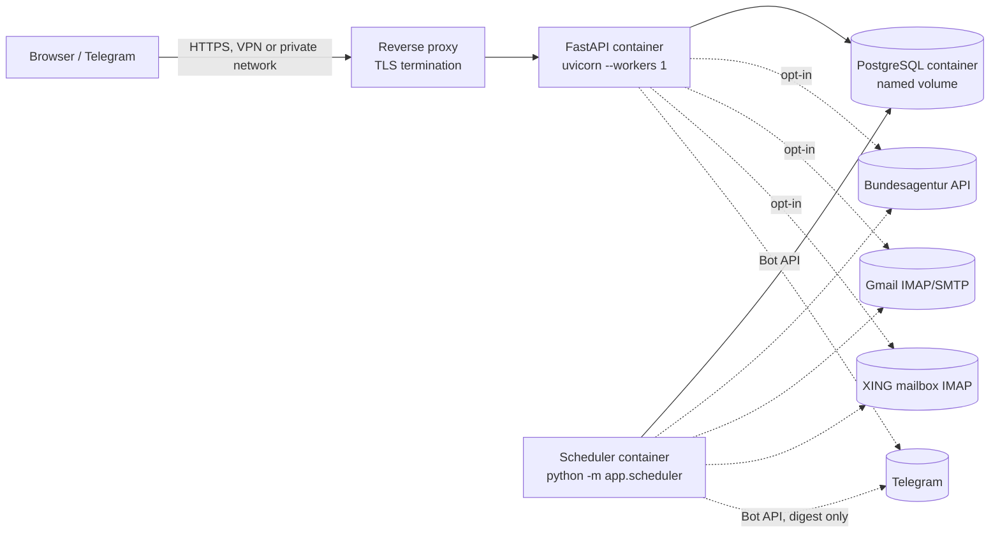

# Deployment Architecture — JobTriage

This document describes the **recommended initial deployment**: a single-server deployment, not a multi-worker/distributed one. See `docs/PRODUCTION_READINESS_AUDIT.md` for why multi-worker and public-internet exposure are not yet recommended (AUD-003, AUD-004).

## Target topology



## Why single-server, not distributed, first

The application's own design already assumes a single-server shape:
- The FastAPI process's lifespan **deliberately never starts the scheduler** (`app/main.py`, `app/scheduler.py` module docstring) — this avoids "N uvicorn workers → N schedulers."
- The in-memory rate limiter (`app/security/rate_limit.py`) is per-process (AUD-004) — safe only under a single FastAPI worker.
- Automation/scheduler overlap safety is enforced at the database level (lease + CAS), which tolerates multiple *instances* of the scheduler existing but only makes sense as **exactly one intended instance** in normal operation.

Scaling beyond single-server is future work requiring: a shared rate-limit store (Redis), reverse-proxy-aware client IP resolution, and re-validation of the lease/CAS design under real multi-instance load — none of which is implemented or claimed here.

## Scheduler strategy: Option A vs Option B

**Option A — single FastAPI worker with scheduler inside the same process.** Rejected. It would require changing `app/main.py`'s lifespan to start the scheduler loop, contradicting the codebase's own explicit, documented design decision **not** to do this (to keep the FastAPI process's worker count independent from "how many scheduler loops exist"). Implementing Option A would be an application-behavior change, out of scope for this deployment-only branch.

**Option B — web container + dedicated scheduler container/process. RECOMMENDED.** This matches what the code already does: `python -m app.scheduler` is a separate entrypoint, designed from the start to run as its own process, independent of how the web process is scaled. Chosen because:
1. Zero application code changes required — the separation already exists.
2. A crashed scheduler cannot take down the web API, and vice versa.
3. `docker compose` naturally expresses this as two services sharing one database.
4. It keeps "exactly one scheduler instance" an explicit deployment/orchestration guarantee (`replicas: 1`, no restart-storm auto-scaling) rather than something the app has to defend against itself — though the DB-level lease/CAS design means even an operator mistake (two scheduler containers) fails safe, not silently duplicated.

## Containers

| Service | Image | Purpose | Replicas |
|---|---|---|---|
| `db` | `postgres:16` (official) | Persistent state | 1 |
| `web` | built from this repo's `Dockerfile` | FastAPI app (`uvicorn app.main:app --workers 1`) | 1 |
| `scheduler` | same image, different command (`python -m app.scheduler`) | Automation cycle + Telegram digest ticks | 1 (must never be scaled) |

No reverse proxy container is included in `compose.yaml` by default — see "Reverse proxy / TLS" below for why that's left to the deployment environment rather than bundled.

## Ports

- `web`: listens on `8000` in the container and is published on **loopback only**: `127.0.0.1:${WEB_PORT:-8000}:8000` (Stage 13A). Nothing on the network can reach the API directly; external access goes through a host reverse proxy. If the proxy is ever moved inside Docker, the preferred shape is an internal compose network with **no** host-published `web` port at all.
- `db`: `5432`, not published to the host by default (only reachable by `web`/`scheduler` on the compose network) — reduces the accidental-exposure surface.
- `scheduler`: no listening port; outbound-only (DB, IMAP, SMTP, Bundesagentur, Telegram).

## Network

Single default `compose` bridge network. `web` and `scheduler` both reach `db` by service name (`db:5432`). No service other than `web` (and optionally a reverse proxy) should ever be reachable from outside the host.

## Persistent volumes

- Named volume for PostgreSQL data (`pgdata:/var/lib/postgresql/data`) — survives `docker compose down` (not `down -v`).
- No other persistent volume is required: the app has no `tempfile` usage (verified — AUD audit), and generated CV/Bewerbung content is stored in the database, not the filesystem.

## Database

- Production compose target is **PostgreSQL only** — SQLite is a local-dev/test convenience, not used in the compose file (per explicit instruction: "do not use SQLite in production compose").
- `DATABASE_URL` supplied via environment variable, e.g. `postgresql+psycopg://<user>:<password>@db:5432/<db>`; the `postgres` extra (`psycopg[binary]`) must be installed in the image (it is — see `docs/DOCKER.md`).

## Migration strategy

- `ALEMBIC_AUTO_UPGRADE` **must stay `false`** in this deployment (the app already defaults to this and documents it as a hard production rule — `app/db/session.py`).
- Migrations run as an **explicit, separate step**, before the `web`/`scheduler` containers start serving traffic: `docker compose run --rm web alembic upgrade head` (or an init container / CI/CD pipeline step). This makes migration failure loud and blocking rather than silently skipped or racily run once-per-worker.
- The expected schema revision is whatever the deployed code's migration scripts declare as their single head — it moves with every new migration, so this document deliberately does not pin a literal (an earlier version named `a1b2c3d4e5f6`, long since stale). Verify it after every upgrade, against the same image:
  ```bash
  docker compose run --rm web alembic heads     # must print exactly ONE line ending in "(head)"
  docker compose run --rm web alembic current   # must print that same revision followed by "(head)"
  ```
  Exactly one head, and `alembic current` equal to it, is the deployment invariant; `GET /api/v1/ready` enforces the same equality at runtime. The CI `scheduler-postgres` job asserts it too, against a literal that `tests/test_ci_postgres_migration_gate.py` keeps equal to the scripts' head.

## Secrets

- No secrets are baked into the image. All configuration (API key, IMAP/SMTP credentials, Telegram token, DB URL) is supplied via environment variables at container-run time — matching the existing `pydantic-settings` `Settings` model, which already reads exclusively from env/`.env`.
- `compose.yaml` reads secrets from a `.env` file (git-ignored) or the orchestrator's own secret-injection mechanism (Docker secrets, Kubernetes secrets, systemd `EnvironmentFile`, etc. — whichever the actual host environment provides). `.env.example` (already in the repo) documents every variable with a placeholder value; it must never contain real credentials.

## Health checks

- `db`: PostgreSQL's own `pg_isready` (already the pattern used in `.github/workflows/ci.yml`'s `scheduler-postgres` job) — reused verbatim in `compose.yaml`.
- `web` (Stage 13A, AUD-002 resolved): two endpoints with different jobs.
  - `GET /api/v1/health` — **liveness** only: the process is up. Never touches the database.
  - `GET /api/v1/ready` — **readiness**, and the compose healthcheck target: `200 {"status":"ready"}` only when the database answers a read-only query **and** its Alembic revision is exactly the image's single head; otherwise `503 {"status":"not_ready"}` (no reason, revision or error text in the body; the reason category is logged). It never migrates or writes — with `ALEMBIC_AUTO_UPGRADE=false`, a schema behind the code stays "not ready" until the explicit migration step runs.
  - Bounded inside the 5 s healthcheck timeout at the driver level (`app/services/readiness.py`): its own `NullPool` engine (no pool wait), PostgreSQL `connect_timeout=2`, `statement_timeout=1500ms`, `tcp_user_timeout` + keepalives. A host name resolving to several addresses multiplies the connect bound per address; compose's `db` resolves to one.
  - Docker does not restart an unhealthy container by itself: an unhealthy `web` is a signal in `docker compose ps`, not a restart loop.
- `scheduler`: no HTTP surface to health-check; operational health is inferred from container "running" state plus log inspection (see `docs/RUNBOOK.md`) — a process-level `docker compose ps` check plus log-tailing is the practical signal here.

## Restart behavior

- `web` and `db`: `restart: unless-stopped` — recover automatically from a crash or host reboot, but don't fight an intentional `docker compose stop`.
- `scheduler`: also `restart: unless-stopped` (DEPLOY-001..4 Codex master review, DEPLOY-002). `on-failure` was tried first (see `docs/TECHNICAL_DEBT.md` TD-032 and `docs/DOCKER.md`'s smoke-test log) because `python -m app.scheduler` used to exit `0` immediately whenever both `AUTOMATION_SCHEDULER_ENABLED` and `TELEGRAM_DAILY_DIGEST_ENABLED` are `false` — but `on-failure` is never restarted by the Docker daemon on its own startup/host reboot regardless of exit code, so a deliberately-enabled scheduler could silently stay stopped after a host restart while `web`/`db` resumed normally. The real fix is in `app/scheduler.py`: a disabled scheduler now idles in a no-op loop instead of exiting, so it never exits `0` on its own — `unless-stopped` therefore both resumes it after a daemon/host restart (what `on-failure` could not do) and never restart-loops it while disabled (what `on-failure` was originally chosen to avoid). When the scheduler is actually enabled, a restarted instance is safe by design (lease/CAS reconciliation, AUD-008's SIGTERM fix) even if it was mid-cycle when killed.
- `web` must not start accepting traffic before `db` is healthy — expressed via compose `depends_on: db: condition: service_healthy`.

## Backups

- Out of scope for this application to implement itself — standard PostgreSQL backup practice applies: `pg_dump`/`pg_basebackup` against the `db` container/volume, or the managed-Postgres provider's own backup mechanism if deployed there instead of a self-hosted container. See `docs/RUNBOOK.md` for a concrete backup/restore procedure sketch using the actual container names this compose file defines.

## Logging

- The app already emits structured JSON logs (`app/core/logging.py`) to stdout — this is container-native; no additional logging infrastructure is required for basic operation. Aggregate via the orchestrator's normal log-collection mechanism (`docker compose logs`, or a real log shipper in a more mature deployment) — not implemented or assumed here.

## Reverse proxy / TLS

- Not bundled in `compose.yaml` — TLS termination and the reverse proxy are an environment-specific decision. The approved initial topology is `Internet -> host nginx -> 127.0.0.1:WEB_PORT -> FastAPI`.
- **Client identity (Stage 13A, AUD-003 resolved):** the container runs Uvicorn with `--no-proxy-headers`, so Uvicorn never rewrites the client address (its own default would trust `127.0.0.1` and any `FORWARDED_ALLOW_IPS` from the environment). The application alone decides proxy trust (`app/security/client_identity.py`):
  - `TRUSTED_PROXY_IPS` (comma-separated **literal** IPs, no CIDR, no host names) is **empty by default** — then every forwarding header is ignored and rate limiting keys on the TCP peer.
  - Only when the immediate peer is a listed address is exactly one header read: `X-Real-IP`, holding exactly one bare IP literal. Missing, repeated, list/comma, padded, port, IPv6-zone or malformed values fall back to the peer (one shared bucket — degraded, never spoofable). `X-Forwarded-For` and `Forwarded` are never interpreted.
- **nginx contract:** nginx must **overwrite** the header with the real remote address, never pass through client-supplied content:
  ```nginx
  proxy_set_header X-Real-IP $remote_addr;
  ```
- **Configuring the trusted peer (do not guess it):** with Docker's port publishing, FastAPI may see a Docker gateway/NAT address rather than `127.0.0.1` for host-nginx traffic. Do **not** guess that address and do **not** list a Docker subnet. First observe the actual immediate peer of proxied requests in the intended deployment (for example from a temporary debug log of `request.client.host` on one test request), confirm it is inside the local-host trust boundary (only host nginx can originate from it), then set `TRUSTED_PROXY_IPS` to exactly that one address. An invalid entry makes the app refuse to start.

## Rate-limit implications

Limits are per process (AUD-004, accepted for the initial topology): run exactly one `web` replica (`--workers 1`, one container; the fixed host-port mapping also makes `--scale web=2` fail) so the configured limits mean what their numbers say. Behind a proxy, buckets are per real client only once `TRUSTED_PROXY_IPS` names that proxy (see above); until then all proxied clients share the proxy's bucket. Rate limiting still runs after API-key auth (HARD-015) and the key comparison is not constant-time (AUD-006) — acceptable only because the API has no direct network exposure (loopback bind); keep it that way.

## Scaling limitations (explicit, honest)

- **Not multi-worker safe today** (AUD-004): stay at `--workers 1` / one `web` container.
- **Not designed for direct public internet exposure** (HARD-015, AUD-006): the API is loopback-only by default; expose it only through the reverse proxy described above.
- **PostgreSQL production use is not yet field-tested by the author** (AUD-011) — CI proves migrations and concurrency correctness, but this compose target has not yet run as a long-lived production workload; treat an initial rollout as monitored, not "fire and forget."
- The `scheduler` service must never be scaled beyond 1 replica — DB-level lease/CAS makes extra instances merely redundant rather than harmful, but there's no reason to run more than one.
